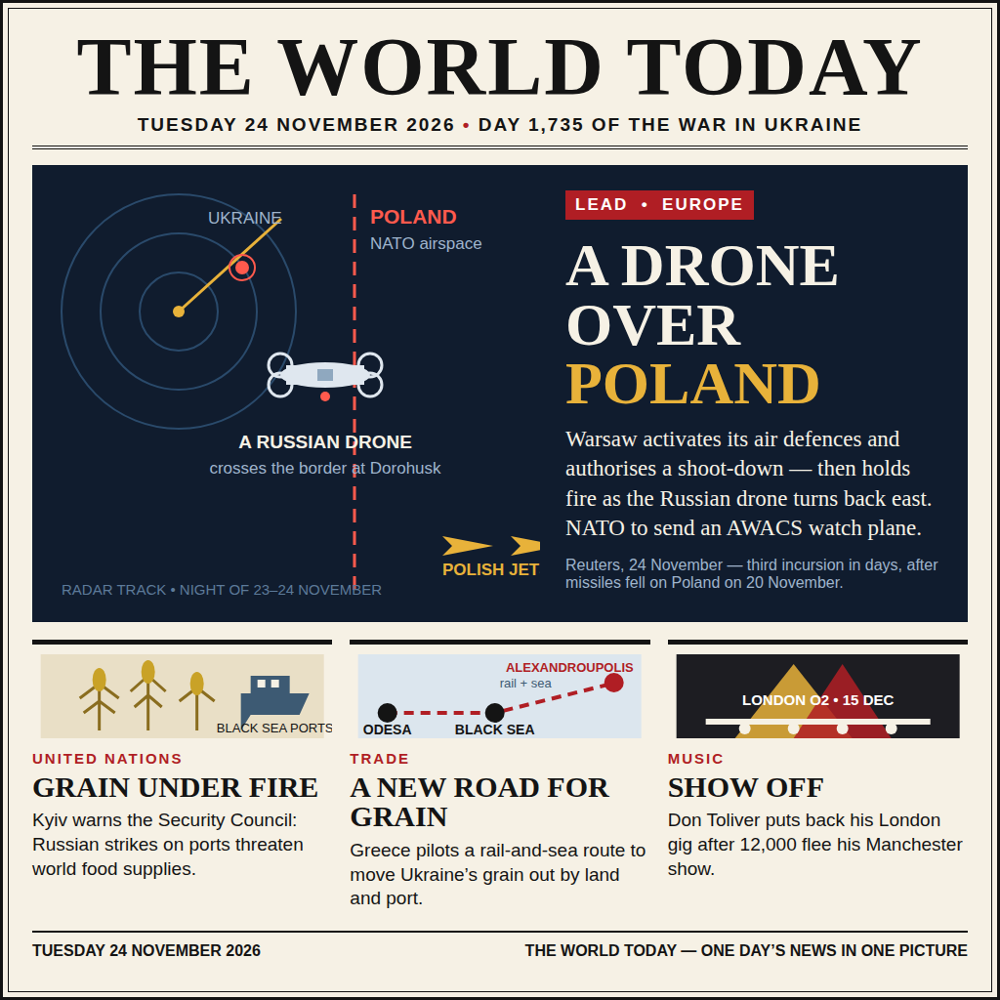

# THE WORLD TODAY — Tuesday 24 November 2026

[](https://make.fun/c/news-image-20261124)
[](https://make.fun/c/news-image-20261124)
[](https://make.fun/c/news-image-20261124)

Entry for the make.fun bounty [Sum up 24 November's world news in one image](https://make.fun/c/news-image-20261124).

## The image

A newspaper front page, **THE WORLD TODAY**, dated **TUESDAY 24 NOVEMBER 2026**,
summing up the day's world news in one picture.



## Stories pictured

- **A drone over Poland.** A Russian drone briefly enters Polish airspace near
  Dorohusk during the night's attack on western Ukraine. Poland activates its
  air defences and authorises a shoot-down, then holds fire after the drone
  turns back east. NATO is to send an AWACS early-warning aircraft. Third
  incursion in days, after three Russian missiles fell on Poland on 20 November.
- **Grain under fire.** Ukraine's foreign minister Andrii Sybiha tells the UN
  Security Council that Russian strikes on Ukrainian ports and export routes
  threaten global food security.
- **A new road for grain.** Greece pilots a multimodal rail-and-sea route to move
  Ukraine's grain out via the port of Alexandroupolis, an alternative to the
  Black Sea ports under attack.
- **Show off.** Don Toliver postpones his London O2 Arena show to 15 December
  after more than 12,000 people were evacuated from his Manchester Co-op Live
  concert when an unknown substance left 89 with symptoms.

The front page was duel-tested against two other layouts built the same morning
(a map-led "bread routes" front page and a dark poster, "HELD FIRE"). The
broadsheet won: it leads with the day's most consequential story, its
radar-and-drone scene reads at a glance, and it stays legible at ~300 px wide.

## How it runs

`main.ts` (Node 22, standard library only) copies `entry.png` to
`$MAKEFUN_OUTPUT_DIR/entry.png` (default `/output`), creating the directory
if needed. It takes no input and writes the same bytes on every run:

```sh
mkdir -p out && MAKEFUN_OUTPUT_DIR=out node main.ts
```

Deterministic: two runs write byte-identical files (same sha256), and the
image is 1024×1024 at 186,546 bytes, under the 1 MiB cap.

## Sources

- Reuters, 24 November 2026 — Russian drone briefly violates Polish airspace;
  NATO to deploy AWACS aircraft to Poland.
- h.ua / UN Security Council, 24 November 2026 — Ukraine warns Russian attacks
  on ports threaten global food security; Greece develops multimodal freight
  route between Ukraine and Alexandroupolis.
- Associated Press, 24 November 2026 — Don Toliver postpones London O2 show
  after Manchester Co-op Live evacuation.
